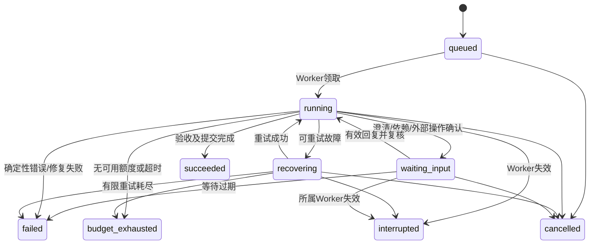

# AgentBuddy 首版实施计划

日期：2026-11-10  
状态：T01–T16 本轮可执行范围完成；T17 正确性收口、15类业务验收与人工审阅反馈完成，见 docs/validation/T17.md；DeepSeek 的 A–F 场景、Windows/Linux WSL、备份恢复和浏览器验收通过。Qwen/Claude 实服务按用户要求暂缓。证据见 docs/validation/T16.md。  
需求基线：[Spec](docs/specs/platform.md)，F1–F10 / 场景 A–F。  
本轮追加确认：首版同时支持 Qwen、DeepSeek、Claude 原生接口；Agent 编排采用 AgentScope 2.0 系列 Python 版本；后端所有接口统一配置前缀；SQLite 持久化任务，首版不加 Redis、不做可视化工作流编辑器；兼容性按默认稳定版本起步。

本计划描述首版落地方案，任务状态与验证记录区分计划和实际实现。当前已有工程、SQLite/Alembic、独立 Worker、模型设置、三家原生文本/工具协议适配、持久化业务 Run、SSE 与两轮对话；DeepSeek 已按用户授权复用 Globex 配置完成真实联通及两轮文件版本验证。T05–T10 实现接口/数据细化见 [专项设计与验收](docs/plans/T05-T10.md)。本文是本项目首版主计划，按用户要求放在根目录，不另建重复计划。

## 1. 设计决定与边界

| 决定 | 推荐落地方式 | 理由 |
| --- | --- | --- |
| 前端 | React + TypeScript + Vite，React Router、TanStack Query；轻量会话草稿状态 | 页面与远程状态分离，不引入 SSR |
| API | Python + FastAPI + Pydantic，按业务模块组织路由 | 明确契约并生成 OpenAPI |
| 数据 | SQLAlchemy + Alembic + SQLite，短事务、WAL、本机磁盘 | 支持有版本的迁移，无独立数据库服务 |
| 执行 | 单个独立 Python Worker，asyncio 调度，受控普通子进程 | 与 HTTP 生命周期分离，支持多任务/多专家有限并发 |
| 通信 | API 写 SQLite 任务；Worker 领取；API 读取持久事件通过 SSE 推送 | 不引入 Redis；浏览器断开不影响执行 |
| Agent 内核 | AgentScope 2.0 系列 Python 版本，平台适配层封装 | 复用框架的 Agent 执行与协作能力，落实平台单层协作规则 |
| 模型 | 平台 ProviderAdapter 契约，优先复用 AgentScope 对应原生模型适配，缺口单独补齐 | 保留原生差异，避免重复维护整套模型循环 |
| 文件 | 项目输入、运行工作区、不可变成功快照分开 | 避免改坏输入和历史版本 |
| 办公 | python-docx、openpyxl、python-pptx；LibreOffice 重算/渲染，PDF 页面提取用于检查 | 写文件、计算、视觉验证是三个独立步骤 |
| 部署 | 单台主机上的 API、Worker、前端静态站点；SQLite 不放网络共享盘 | 保持已确认单机范围；开发兼容 Windows，交付冒烟覆盖 Linux 服务器 |

不引入复杂账号体系、沙箱、跨设备 Windows 桥接、计费、公开市场、递归 Agent、版本分支或可视化工作流编辑器。执行过程展示仍在首版范围内。普通进程和项目路径组织不构成强隔离。用户指定服务器环境不同于推荐基线时可调整启动脚本，不改变产品范围。

Python 默认使用 3.12；AgentScope 2.0 官方要求 Python 3.11+。AgentScope 限定 2.0 系列，其余依赖采用满足技术约束的默认稳定版本，在 T01 完成最小兼容验证后写入锁文件；不使用浮动 latest 作为交付依赖，不为常规补丁选择另行询问用户。首版不使用无人维护的“所有提供方自动兼容”假设。

### 1.1 配套工程默认值

配套选择不再作为阻塞实施的待决事项：UI 使用 Ant Design；页面路由和远程状态分别使用 React Router、TanStack Query；Python 依赖使用 uv，前端使用 pnpm；后端测试/检查使用 pytest、Ruff，前端使用 Vitest、Testing Library、Playwright。生产部署默认 Nginx 提供静态资源并反向代理 Uvicorn，Worker 独立启动。MCP 使用官方 Python SDK，经平台 ToolGateway 与 AgentScope 桥接；不重复维护两条工具执行通道。

### 1.2 接下来如何推进

1. **T01 工程初始化**：创建前后端骨架、配置与锁文件、统一页面/API 前缀、健康接口和开发启动方式；验证 AgentScope 2.0 可导入与最小执行接口。没有模型凭证时如实记录真实调用未验证。
2. **T02 持久化与 Worker**：落实数据库字段、约束和迁移，完成 SQLite 任务领取、事件记录、心跳及中断处理。
3. **T03–T04 首条对话闭环**：平台模型配置与三家适配，接通提交任务、AgentScope 执行、SSE 输出和刷新恢复。单家先接通可用于开发演示，不代表三家接入已完成。
4. **T05–T10 单专家能力闭环**：依次落实预算/确认、上传、Skills、专家绑定、MCP、文件快照与下载。
5. **T11–T15 协作与业务交付**：加入多专家编排、Word/Excel/PPT 与开发/资料整理预置能力，验证实际文件交付。
6. **T16 首版验收**：汇总场景 A–F、三家真实模型、部署、迁移及备份还原证据，逐项列明通过、失败或受阻项。

每个任务按“补充局部实现设计 → 编码与测试 → Check → 更新任务状态”推进。复杂状态、并发预算和版本操作优先先写行为测试。无需先完成全项目的逐函数设计，也不把 Test 和 Check 推迟到 T16。按用户授权推进实施，只有具备验证证据的任务才标记完成。

## 2. 目录与模块设计

以下为目标目录结构；T01–T02 已创建工程、持久化与 Worker；尚未实现的业务目录按后续任务创建。

```text
backend/
  pyproject.toml
  src/agentbuddy/
    api/                  # 路由、请求/响应、SSE；不执行模型循环
    config/               # 统一前缀、路径、限制、默认角色
    catalog/              # 模型、专家、Skills、连接器配置
    projects/             # 项目、对话、附件、会话能力覆盖
    runtime/              # 平台运行状态、预算、等待、单层调度
      agentscope_bridge/  # AgentScope 构建、模型/工具桥接、事件与状态转换
    providers/            # qwen / deepseek / claude
    tools/                # 内置工具、MCP 客户端、进程执行与确认
    artifacts/            # 输入提取、产物清单、验证、快照
    office/               # Word / Excel / PPT 处理与渲染
    persistence/          # 表、仓储、事务、事件存储；migrations/ 随 Python 包分发
    worker/               # 任务领取、心跳、清理、启动恢复
  tests/{unit,integration,contracts}/
frontend/
  src/{app,api,components,features}/
  tests/
presets/{agents,skills,office-templates}/
tests/e2e/
docs/validation/
data/                     # 运行数据，不提交 Git
```

| 模块 | 拥有的职责 | 关键内部接口 | 不承担 |
| --- | --- | --- | --- |
| Catalog | 可用模型、专家修订、Skill 包与版本、工具清单 | resolve_agent / get_skill_version / list_tools | 执行任务 |
| CapabilityResolver | 默认能力 + 会话增减 + 禁用/缺失情况，生成预览与快照 | resolve(selection) → EffectiveCapabilities | 修改专家模板 |
| ProjectService | 首次发送建项目、消息、附件归属、下一轮选择 | submit_turn / attach_uploads / update_selection | 持续占用模型连接 |
| RunService | 创建运行、状态转换、取消、用户输入、事件 | create / transition / request_cancel / provide_input | 自己调用外部工具 |
| AgentScopeBridge | 按运行快照构建 AgentScope Agent、注入 Skill、驱动框架循环并转换事件 | execute(context) → AgentResult | 自建第二套模型-工具循环或任意递归派发 |
| Supervisor | 固定总控通过 AgentScope 选择既有专家并汇总；平台校验依赖、限制并发和单层派发 | build_plan / schedule / collect | 改写子专家能力 |
| BudgetService | 并发调用额度、计时、等待与超时 | reserve_call / settle_call / pause / resume | 用 token 数猜测调用次数 |
| ToolGateway | 工具参数验证、作用类型、确认、预算与执行入口 | propose / invoke / reconcile | 把参数流片段提前执行 |
| ArtifactService | 工作目录、合并冲突、格式检查、版本提交 | stage / validate / publish_snapshot | 原地编辑成功快照 |
| EventStore | 有序事件、恢复查询、增量消息落盘 | append / read_after | 让 SSE 成为唯一状态来源 |

API 与 Worker 共享业务服务和数据契约，不共享可变 Python 全局状态。Worker 是进程型 MCP 和任务子进程的唯一生命周期所有者。

### 2.1 AgentScope 与平台职责边界

- AgentScope 负责 Agent 执行、模型与工具交互及多 Agent 编排基础能力；平台通过适配层接入，不把框架内部对象直接作为 HTTP 或数据库契约。具体类名和扩展点以锁定的 2.0 版本为准，不混用旧版本示例。
- Worker 驱动框架运行；SQLite 中的 Run/Task、预算、确认记录和持久事件仍是平台业务事实来源。框架状态如需保存，单独带版本标记，不据此承诺任意故障点恢复。
- 每个主/子 Agent 按自己的能力快照构建；Skill 按需读取，MCP 和脚本工具经 ToolGateway 包装后注册。框架工具调用也必须经过预算、取消和外部操作确认，不能另开直通入口。
- 平台维护协作候选范围、依赖图和并发额度；复用 AgentScope 的执行能力，不同时实现另一套完整 Agent 推理循环。
- T01 验证版本兼容；T03–T05 验证原生模型、流事件、调用计数、工具拦截、等待后续行和取消扩展点。框架能力缺口通过薄适配补齐，不默默取消产品约束。

## 3. 模型接入设计

### 3.1 首批适配范围

用户明确要求 Qwen、DeepSeek、Claude；推荐官方直连，不默认 AWS Bedrock、Vertex、代理网关或统一转发服务。连接地址仍允许配置；Qwen 地域/工作空间参数按实际账号填写，不在源码写死。

| provider_type | 首版协议 | 需要单独处理 |
| --- | --- | --- |
| qwen_dashscope | DashScope 原生文本/多模态 Generation 接口 | 地域/工作空间、增量与累计响应、工具字段及模型能力 |
| deepseek | DeepSeek 官方 Chat Completions | 官方工具调用与流式字段，必要时保留 reasoning_content 等协议续传字段 |
| claude | Claude 原生 Messages API | system 顶层字段、content blocks、tool_use/tool_result、stop_reason 与流式块 |

DeepSeek 官方接口采用 Chat Completions 形式并不意味着绕到 OpenAI 服务。三家均各有契约测试，不能仅替换 base_url 就宣称原生全兼容。具体模型 ID 由平台配置，不承诺所有同厂模型都支持工具或视觉。

### 3.2 内部契约

```text
ModelRequest:
  system_instructions, messages[], tools[], model_config,
  output_limit, timeout, cancellation
ModelMessage:
  role, content_blocks[], tool_calls[], tool_results[], provider_state?
ModelEvent:
  text_delta | tool_call_delta | usage | completed | failed
ModelResponse:
  text, complete_tool_calls[], finish_reason, usage?, provider_state?
```

ProviderAdapter 是平台边界契约；优先委托锁定版本的 AgentScope 原生模型实现，适配消息、流事件与能力探测，仅在缺失处实现提供方专用转换，不重复请求模型。它负责 encode_request、stream、decode_response、probe；不让 provider-specific 参数散落进 Supervisor。必须聚合并校验完整工具参数后才执行。响应截断、工具参数 JSON 不完整不能当正常完成；失败修复请求仍计调用预算。

协议续传所需原始块单独保存为私有运行状态，不向 UI 展示内部推理；跨模型的下一轮只传公共对话、摘要、文件引用，不把一家专有续传块发送给另一家。平台关闭 SDK 隐式重试，由统一运行层显式计数。

模型能力字段：text、tools、streaming、vision、context_window、max_output_tokens、tested_at、test_status。专家执行至少需要通过 text + tools 测试；办公视觉审查选用已测试 vision 模型，允许与主专家模型不同。无可用视觉模型或渲染器时办公验证依赖明确缺失，不能称视觉检查通过。

用户已明确选择本轮先完成本地协议验证，真实联通留待在设置页配置后验收。本地使用合成原生协议服务和测试凭证；真实环境仍需为三家各执行“文本 → 工具请求 → 工具结果 → 最终回答”的探测。

### 3.2.1 T03–T04 已落地边界

- 锁定的 AgentScope 2.0.11 内置 DashScope 模型使用兼容接口。为保持原生要求，平台以 ChatModelBase 实现 NativeModel，分三家编码/解码，并复用 AgentScope formatter 与 Agent 执行循环；HTTP 使用显式依赖 httpx，无第二套 Agent 推理循环。
- 本阶段支持 Qwen 原生文本 Generation、DeepSeek Chat Completions、Claude Messages 的文本流及工具协议；三家都有合成原生响应契约测试。视觉能力固定为未验证，当前探测只接受 text+tools 联合检查，拒绝悄悄忽略 vision 请求；视觉验证在办公相关阶段补齐。
- 凭证独立保存、读取不回显；变更生成新的凭证引用。可用模型必须探测通过且模型/提供方修订匹配。新请求快照不含密钥，已排队任务不受后续配置修改影响。
- T04 仅普通文本对话，无可执行外部工具。运行默认最多 180 秒，框架与 HTTP 隐式重试关闭；上下文按保守字节上界预检，超限明确失败。共享预算、取消与等待机制按 T05 完成，摘要压缩不冒充已实现。
- OpenAPI 响应模型导出 frontend/openapi.json，TypeScript 生成类型由前端引用。TypeScript 使用 5.9.3 以满足 openapi-typescript 兼容要求。

### 3.3 上下文策略

每轮包含当前角色、有效 Skill 摘要、用户需求、必要会话摘要、最近完整交互和文件引用。附件分块提取，按需读取，不把所有文件直接塞入 prompt。压缩只移除完整历史轮次，不能留下孤立 tool_result；摘要保留待办、用户约束、来源引用。摘要调用计预算；无额度时不能暗中调用模型压缩，返回明确上下文限制。先不引入向量库或 RAG 服务。

## 4. API 契约

`API_PREFIX` 默认 `/api/v1`，FastAPI 根 APIRouter 统一挂载所有业务路由；子模块只声明相对路径。健康检查、SSE、上传下载、模型探测均遵循此规则。OpenAPI、Swagger UI 和 ReDoc（如启用）的地址及引用也使用此前缀。`root_path` 仅处理反向代理挂载，不用它代替真实 API 路由前缀。前端通过统一 API 客户端读取配置。验收将前缀改为 `/custom/api/v1`，检查 OpenAPI 路径、健康检查、业务请求、SSE 与下载均可用，旧前缀无重复入口。

所有下列路径挂在 `API_PREFIX=/api/v1` 下。前端页面基路径独立为 `/app`，前缀由单一配置注入；OpenAPI 契约生成 TypeScript 类型，避免手工维护两份 DTO。

### 4.1 通用约定

- UUID 字符串标识；UTC ISO 时间，前端本地化；snake_case 字段；修改资源携带 revision 防止覆盖并发编辑。
- 普通响应 `{data: ...}`；列表 `{data: [], next_cursor: null|str}`；错误 `{error:{code,message,details,retryable},request_id}`。
- 创建配置 201；异步执行/检查 202；非法状态或版本冲突 409；大小超限 413；格式/参数错误 422；资源不存在 404。
- 创建运行要求 `Idempotency-Key`；同 key 同请求返回原结果，不同请求 409。前端网络重试不会创建两轮或两个项目。
- `Operation` 表示连接检查、解析等短后台任务；`Run` 表示业务任务。两者分开，配置测试不消耗运行预算。
- 密钥写入独立配置字段，读取只返回 configured/masked 状态；不出现在专家提示词、会话快照、SSE 或导出中。不建设额外秘密管理服务。

T03–T04 当前 POST /runs 接受 project_id?、model_id?、message；模式固定 general，附件、专家选择及预算字段尚未开放，额外字段返回 422。默认模型从平台 settings 读取；无可用模型时不创建项目。配置及对话响应采用 data 包装，列表 next_cursor 暂为 null；T01–T02 基础设施接口保留既有直接响应。模型探测返回 Operation，checks 当前要求 text+tools；无 vision 假成功。

### 4.2 配置与能力接口

| 方法与路径 | 输入要点 | 输出/行为 |
| --- | --- | --- |
| GET /settings | — | 前缀、默认模型、预算默认/上限、上传限制、运行依赖健康状态 |
| PATCH /settings | revision + 允许修改项 | 更新配置，运行预算不追溯改变 |
| GET/POST /providers | provider_type/name/base_url/credential/config | 提供方配置列表/创建 |
| PATCH /providers/{id} | revision + 配置 | 保存不代表联通成功 |
| GET/POST /models | provider_id/model_id/capabilities/context limits | 模型列表/创建；模型名允许手填，不依赖自动发现 |
| PATCH /models/{id} | enabled/config/revision | 不静默替换已选模型 |
| POST /models/{id}/test | text/tools/vision 测试项 | 202 Operation；执行最小真实探测 |
| GET/POST /agents | name/role/model_id/skills/tools/collaborators | 列表/创建专家，含 default general/coordinator |
| GET/PATCH /agents/{id} | revision + 完整绑定变更 | 详情/新配置修订；启用/禁用代替首版硬删除 |
| GET /skills | q/source/installed/enabled | 预置和用户包目录，状态分离 |
| POST /skills/import | Skill ZIP multipart | 202 Operation；返回新 Skill 版本或解析错误 |
| POST /skills/{id}/install | version_id | 安装服务端已有包，无需客户端下载 |
| PATCH /skills/{id} | enabled/current_version/revision | 后续运行采用选定版本，旧包保留 |
| GET /skills/{id}/versions/{version_id} | — | 元信息、文件目录和说明；不执行 |
| GET/POST /connectors | name/transport/config/credential | remote streamable_http 或 stdio |
| PATCH /connectors/{id} | config/enabled/revision | 更新配置并使旧测试状态过期 |
| POST /connectors/packages | MCP ZIP multipart | 上传程序包并检查入口，返回 package_id |
| POST /connectors/{id}/test | — | 202 Operation：连接、发现工具、状态 |
| GET /connectors/{id}/tools | — | 工具 schema、effect 类型、最近发现状态 |
| PATCH /connectors/{id}/tools/{tool_id} | effect/label/revision | 标注 read/project_write/external_write/unknown |
| POST /capabilities/resolve | mode/agent_id/overrides | 预览最终能力、来源和缺项，不调用模型或启动业务任务 |
| GET /operations/{id} | — | 后台配置测试/解析结果 |

连接器凭证首版支持服务端配置的 Bearer/自定义 headers 及 stdio env；完整交互 OAuth 登录流程后置，文档和 UI 明确该兼容范围。上传 MCP 程序可配置 Python 或 Node 启动命令，缺少运行时/依赖返回具体缺项，不自动无限安装依赖。

### 4.3 项目、运行与文件接口

| 方法与路径 | 输入要点 | 输出/行为 |
| --- | --- | --- |
| POST /uploads | draft_id + files multipart | 暂存附件，202 Operation 处理 ZIP/提取；尚不创建项目 |
| GET /uploads/{id} | — | 上传/提取状态与错误；用于轮询 |
| DELETE /uploads/{id} | 未归属附件 | 撤销草稿附件，不影响历史项目 |
| POST /runs | project_id? + message + attachment_ids + selection + budget | 原子创建首个项目（如需要）、消息、配置快照与运行，202 返回 project_id/run_id |
| GET /projects | cursor | 会话项目列表，含最新运行/文件版本摘要 |
| GET/PATCH /projects/{id} | title 或 selection + revision | 项目信息/下一轮能力选择，不改变当前运行 |
| GET /projects/{id}/messages | cursor | 用户可见对话与附件引用 |
| GET /projects/{id}/runs | cursor | 历史运行 |
| GET /runs/{id} | — | 状态/阶段、预算、等待原因、子任务摘要、产物与验证 |
| GET /runs/{id}/events | after 或 Last-Event-ID | SSE 增量，支持断线补读 |
| GET /runs/{id}/tasks | — | 子任务、依赖、尝试、负责专家 |
| POST /runs/{id}/cancel | — | 幂等请求取消，202；终态不重新开启 |
| POST /runs/{id}/inputs | interaction_id + text 或 resolved_dependency_ids | 回答澄清/依赖补齐通知，不创建新运行或重置预算 |
| POST /runs/{id}/approvals/{id}/decision | approved/rejected + action_digest | 原子确认具体操作，过期/内容变化 409 |
| GET /runs/{id}/files | — | 含部分成果，明确非成功交付 |
| GET /projects/{id}/versions | — | 已提交成功版本 |
| GET /projects/{id}/versions/{v}/files | — | 完整文件清单及验证摘要 |
| GET /files/{id}/content | 文本范围 | 截断文本/提取内容，不执行文件 |
| GET /files/{id}/download | — | 原始文件 |
| GET /projects/{id}/versions/{v}/download | — | ZIP 完整快照 |
| GET /files/{id}/preview | — | 已生成的办公 PDF/预览引用；不等于在线 Office 编辑器 |

同一项目有非终态运行时，新的普通发送返回 409 ACTIVE_RUN；明确的澄清/审批走对应接口。首版串行化同项目全部运行以简化上下文与文件一致性；不同项目仍可并行。前端保留未发送草稿，不能丢失输入。

```json
{
  "project_id": null,
  "message": "根据附件生成报告和数据表",
  "attachment_ids": ["upload-id"],
  "selection": {
    "mode": "team",
    "agent_id": null,
    "overrides": [
      {"kind": "skill", "id": "spreadsheet-skill", "intent": "add"}
    ]
  },
  "budget": {"execution_seconds": 1800, "call_limit": 120}
}
```

mode 为 general/expert/team；expert 必须有 agent_id。首次请求保留显式增减项；既有项目请求可省略 selection 以沿用当前配置。恢复配置失败时保留请求，不创建虚假成功运行。

### 4.4 SSE 事件

每条持久事件含 `id, run_id, task_id?, type, occurred_at, payload`。事件类型：run.status、message.delta、message.completed、skill.loaded、task.started/completed、tool.proposed/started/completed、interaction.required、budget.updated、artifact.created、version.committed、run.completed。

API 从 SQLite 按事件 id 补读，客户端按 id 去重；心跳不落库。文本每约 250 ms 或 4 KiB 聚合落盘，终态/确认/工具结果立即落盘。断线丢失的尾部 token 不构成结果事实，完整 message.completed 与最终运行快照为准。队列背压时合并文本增量，不丢失终态和确认事件。

## 5. 数据结构

公共约定：主键 UUID（事件可用单调 INTEGER），UTC 时间，配置 revision；JSON 用于受 Pydantic 验证的可变结构，关系与关键状态不全塞进 JSON。启用 foreign_keys，索引查询键。配置禁用/版本化，首版不物理删除被运行引用的记录。

T02 实施说明：本节是首版目标模型，不表示所有表已创建。初始迁移 0001_queue 仅创建 operations、worker_instances、events，配置/项目/业务 Run 表在 T03–T05 等对应任务中增量迁移。时间暂以 UTC Unix 秒（Float）存储。Operation 增加 claim_token，用于拒绝过期或重复完成；Worker 增加 pid、started_at。events 当前以 operation_id 外键关联，Run/Task 关联在其实现时扩展。

T02 新增基础设施接口（均带统一前缀）：GET /system/status；POST /system/diagnostics 返回 202 Operation；GET /operations/{id}/events 支持 after/limit 分页。存储检查实际执行临时文件读写，不伪装模型测试。数据库未迁移时状态接口返回 503，存活接口仍可用。

T03–T04 实施增量：0002_chat 增加 credentials/providers/models/settings/projects/runs/messages/request_keys/run_events。运行快照暂存在 runs.snapshot_json，原子保存创建时配置；本阶段没有独立子任务或复杂能力快照，后续扩展时再拆分。Operation 事件与业务 Run 事件分别保存在 events/run_events，业务事件仍为单调 ID，可供 SSE 补读。时间字段延续 UTC Unix 秒。request_keys 当前只服务 POST /runs；后续需要其他 scope 时迁移扩展。

### 5.1 配置与会话表

| 表 | 关键字段/关系 |
| --- | --- |
| settings | key PK, value_json, revision；非密钥配置 |
| credentials | id, value_json, updated_at；仅服务端配置读取，不出 API 明文 |
| providers | id, provider_type, name, base_url, credential_id, config_json, revision, enabled |
| models | id, provider_id FK, model_id, capabilities_json, limits_json, enabled, tested_at/status；UNIQUE(provider_id,model_id) |
| agents | id, name, slug UNIQUE, source, enabled, current_revision_id |
| agent_revisions | id, agent_id FK, version, role_prompt, model_id, description, tags/examples JSON；UNIQUE(agent_id,version) |
| agent_skill_bindings | agent_revision_id + skill_id 联合唯一；使用当前启用版本，运行时固定 |
| agent_tool_bindings | agent_revision_id + tool_id 联合唯一 |
| agent_collaborators | agent_revision_id + collaborator_agent_id 联合唯一；禁止自引用，运行时仅一层 |
| skills | id, slug UNIQUE, name, source, installed, enabled, current_version_id |
| skill_versions | id, skill_id, version, content_hash, package_path, metadata_json, requirements_json；唯一包版本，内容不可覆盖 |
| connectors | id, transport, config_json, credential_id, revision, enabled, health_status, tested_at |
| connector_packages | id, content_hash, path, entrypoint, processing_status |
| connector_tools | id, connector_id, remote_name, schema_json, schema_hash, effect, available；UNIQUE(connector_id,remote_name) |
| projects | id, title, selection_json, selection_revision, latest_version_id nullable, created_at, updated_at |
| messages | id, project_id, run_id nullable, role, content_json, created_at；只存用户可见对话 |
| uploads | id, draft_id, project_id nullable, name, size, hash, storage_path, status, error_json, expires_at |
| files | id, project_id nullable, upload_id/run_id/version_id 可空引用, relative_path, hash, size, mime, storage_path, origin, metadata_json |
| operations | id, kind, payload_json, status, worker_id, claimed_at, result_json, error_json, created_at/finished_at；配置测试与附件处理队列，重启后在途标失败可重试 |

`selection_json` 存模式、agent_id、手动增减意图；不存展开后的能力副本。覆盖以能力稳定 ID 为键，同一能力只有一个 add/remove 意图。切换专家重新解析默认值，移除项最后应用。连接器标签添加其当前可用工具；工具级移除优先于连接器级添加，UI 展示最终工具清单。

### 5.2 运行与交付表

| 表 | 关键字段/关系 |
| --- | --- |
| runs | id, project_id, message_id, mode, status, phase, base_version_id, snapshot_id, worker_id, attempt_epoch, cancel_requested, failure_json, timestamps |
| run_snapshots | id, schema_version, selected_agent_revision, candidate_revisions_json, model_configs_json, skill_version_ids_json, tool_schemas_json, effective_capabilities_json, attachment_manifest_json, selection_json；不含密钥 |
| run_budgets | run_id PK, max_seconds, max_calls, calls_reserved/used, active_ms, active_since, wait_deadline；独立于子任务 |
| tasks | id, run_id, agent_revision_id, kind, goal, input_refs_json, output_contract_json, status, attempt_no, workspace_path, summary |
| task_dependencies | task_id + depends_on_id 联合唯一，发布计划前校验无环 |
| call_attempts | id, run_id, task_id, kind(model/tool), provider_or_tool_id, external_call_id, request_digest, status, dispatched_at, result_ref, error_json, usage_json |
| runtime_messages | id, run_id, task_id, seq, normalized_json, provider_state_json；内部协议状态，与 UI messages 分开 |
| interactions | id, run_id, task_id, kind(clarification/dependency/approval), payload_json, status, response_json, deadline |
| approvals | id, interaction_id, call_attempt_id nullable, target_digest, action_json, status, decision_at, consumed_at |
| events | id INTEGER PK, run_id, task_id nullable, type, payload_json, created_at；索引(run_id,id) |
| artifact_manifests | id, run_id, files_json, expected_outputs_json, validation_report_json, status |
| project_versions | id, project_id, version_no, run_id UNIQUE, parent_version_id nullable, manifest_id, storage_path, status, committed_at；UNIQUE(project_id,version_no) |
| request_keys | scope + key 联合唯一, request_hash, response_json, created_at；防重复提交 |
| worker_instances | id, boot_id, heartbeat_at, status；检测死亡 Worker，不代替分布式调度 |

关键约束：项目非终态运行使用部分唯一索引保证最多一条（queued/running/recovering/waiting_input）。任务、事件、尝试按 run_id 索引；状态更新条件必须带旧状态与 attempt_epoch，过期结果不能复活终态。project_versions 仅 committed 对用户显示为成功版本。

### 5.3 文件布局与快照提交

```text
data/
  agentbuddy.sqlite
  staging/<upload-id>/
  skill-packages/<skill-id>/<version-hash>/
  connector-packages/<package-id>/
  projects/<project-id>/
    inputs/<upload-id>/                 # 原始输入不改写
    runs/<run-id>/
      base/                            # 最新成功版本的实际复制，不能用可写硬链接
      tasks/<task-id>/attempt-<n>/
      delivery/                        # 仅总控合并
      validation/
    versions/<version-id>/             # 完整不可变快照
```

无版本时从输入构建工作区；有版本时从最新成功快照构建，新增附件独立提供，不隐式覆盖同名文件。同路径冲突由合并步骤明确处理。ZIP 必须保持项目内相对路径，拒绝绝对路径、越界路径、符号链接和重复歧义项；这是防意外覆盖的文件正确性要求，不是沙箱。

发布协议（T10 实施细化）：完成验证 → 写唯一 staging 副本并校验 hash → 同磁盘原子改名 → 单个 SQLite 事务登记版本、成功状态和最终消息。复制与渲染不持有写事务。仅已登记版本可下载为成功版；提交前中断保留旧最新版并将任务标中断，未登记目录不自动转正或触发重放。纯问答及无文件变化不新建版本。

## 6. 执行时序与状态

### 6.1 一轮任务

1. 用户在草稿中选择能力并上传附件；附件解析完成后发送。上传不启动 Agent。
2. API 在短事务内处理幂等键、首项目创建、附件归属、消息、会话选择、运行快照和 queued 状态；有活动运行则 409，输入仍保留。
3. Worker 原子领取任务，标记 running/preflight。先检查可静态判断的必需依赖；未知部分通过有限规划解析，规划调用也计预算。
4. 缺依赖进入 waiting_input/dependency，记录配置入口，不开始生成占位成果。依赖未被任务使用时不阻断。
5. general 用默认助手且无分派工具；expert 用指定专家且只能选择预配置协作者；team 用固定总控与快照中的候选专家。
6. 加载适用 Skill 正文与工具，模型产出完整工具请求；ToolGateway 参数校验、确认判定、预算领取后执行。读取结果再进入下一次模型调用。
7. 子专家分别使用自己的配置、工作目录及必要输入；子任务规划使用受验证结构：id/agent_id/goal/depends_on/input_refs/outputs。校验候选、无环、层数及文件责任后调度。
8. 汇总 delivery，执行内容/格式/办公验证；缺失必需产物则修复（计预算）或失败，不能改成普通问答成功。
9. 纯问答保存回答后成功；有效文件变化按发布协议创建版本；无变化不增加版本。提交终态和最终消息后 SSE 通知。

### 6.2 状态转换



status 描述生命周期；phase 为 preflight/planning/executing/validating/publishing，不把每个阶段扩成新终态。运行级等待先停止新派发，待在途调用结算后停止计时；UI 在结算期间展示“正在暂停”，不能显示已暂停而后台继续计时。外部操作拒绝保持待用户处理，可修改目标或取消，不自动跳过后宣布完成。

配置快照与依赖修复：已冻结的角色、Skill 内容、模型选择不随模板编辑改变；但补齐同一逻辑连接器凭证/依赖后可继续。将修复后的连接信息作为显式 dependency_resolution 附在运行事件/状态中，保留原快照；换数据源、工具语义或模型不自动作为修复，应另起运行。调用时复核当前连接是否仍可用，不把旧快照当作永久授权。

### 6.3 调度、进程与恢复

- 一个 Worker 进程，最多同时执行 2 个业务运行；每运行最多 3 个子专家并行；同项目一轮在途。配置 Operation 使用独立小信号量，不能被长任务占满而无法补齐依赖。
- 完全进入 waiting_input 后释放活动运行名额，保留项目占用和挂起状态；有效回复后重新竞争活动名额，并复核等待期限和预算。等待期间不得占住全部 Worker 槽位，阻止其他项目和配置修复。
- Worker 领取用条件更新/短 `BEGIN IMMEDIATE`，避免 API 与 Worker 竞争产生双领取；数据库超时有限重试不包括模型/工具实际执行重试。
- 进程型 MCP 由 Worker 按连接器修订复用客户端会话；未声明可并行的服务调用串行化，配置更新在空闲时重建；API 测试也交给 Worker，避免重复启动两份服务。
- 所有 asyncio await 设置超时或取消路径。脚本用平台可管理的子进程树；Linux 进程组、Windows Job Object 或等价机制分别实现清理。Windows 后台进程不弹可见窗口。
- Worker 使用实例锁避免启动两份调度器（T02 已实现数据库旁的 OS 文件锁；schema 迁移复用同一把锁）；心跳 5 秒一次，失效阈值 30 秒。意外退出后在途运行及等待运行标 interrupted，queued 可由新 Worker 执行；Operation 在途标 failed 并记录 worker_interrupted，不自动重放。Run 的此项实现仍在 T05；用户另起运行才重做工作，不自动重放外部调用。
- 重启先检查发布中的版本与子进程残留；仅依据已记录 PID 与启动标识清理本平台创建的进程，不按通用进程名杀进程。

### 6.4 预算算法

预算独立于专家，统一 reserve → dispatch → settle。预留额度原子满足 `used + reserved < max_calls`；实际发出后 used 加一、reserved 减一。发出前拒绝/取消则释放预留；进程崩溃导致派发状态未知则保守保留为一次尝试并标 interrupted，不为了省计数盲目重发。

计时使用单调时钟累计 active_ms，持久化段起止；API 只展示，Worker 统一结算。排队不计时，运行与自动恢复计时，完全进入用户等待后暂停。超时 watchdog 不依赖工具有响应。预留耗尽时不再派发，但允许已有调用在剩余时长内结算；已足够交付则成功，否则 budget_exhausted。终态拒绝续跑；新运行使用新预算。

## 7. Skills、工具与确认

### 7.1 Skill 包

首版 ZIP 根目录为 `SKILL.md`（允许外层唯一目录），YAML 至少 name/description，附 scripts/references/assets。安装保存不可变版本 hash；更新新增版本，运行 pin 具体 hash。Skill 的可执行脚本从显式工具执行，不因安装自动运行。

可选 `agentbuddy.yaml` 描述 requirements（运行时/包/工具逻辑名）、入口、输出契约、作用类型。缺失该文件的普通 Skill 仍能加载说明，但不能假装其依赖已验证；运行发现缺项按 Spec 等待用户处理。首版脚本基线 Python；Node 作为开发任务和进程型 MCP 运行时，在健康检查中明确是否可用。

内置工具：list_files、read_file、write_file、apply_file_patch、run_script、load_skill、read_skill_resource、ask_user、artifact_validate；分派工具只给 expert/team 主角色。工具大输出写文件并返回有长度限制摘要和引用，不撑爆上下文。

### 7.2 外部操作确认的落实边界

工具注册带 effect：read、project_write、external_write、unknown。内置工具显式标注；MCP 注解用于建议，平台配置最终分类。unknown 先展示操作或补全分类，不能直接默认为无副作用；已明确 read 的调用不反复确认。

外部操作先保存具体 action（服务、工具、目标、参数/正文、附件 hash），计算 digest 并创建 interaction。确认后对相同 digest 创建/消费一次执行许可，重复点击只返回原结果；内容变化形成新 digest。确认在预算领取前完成，不能确认时就提前执行。幂等读/明确可核实的写入可以按策略恢复；写入超时不自动重试，记录 unknown 并等待核实。

本项目没有沙箱：任意上传脚本或任意第三方 MCP 内部可以自行发网络请求，因此不能声称平台能拦截其全部隐藏副作用。实现方式是预置 Skill 将外部变更显式交给 ToolGateway；自定义脚本在执行前声明实际用途，对带外部副作用的脚本展示具体输入并确认。可信扩展必须遵守该契约；未知、不透明脚本无法承诺精确识别内部操作。该限制必须出现在扩展文档和验收报告，不能以“已实现审批”掩盖。

## 8. 办公与初始能力包

### 8.1 预置能力

| 专家 | 首批 Skills | 真实交付 |
| --- | --- | --- |
| 通用助手 | 文件读取与整理、基础文本/数据文件 | 问答、整理后的文件 |
| 开发专家 | 分析-计划-实现-测试流程、代码文件生成与检查 | 源码、运行说明、实际测试证据 |
| 资料整理专家 | 内容提取、归纳、来源引用 | Markdown、CSV/JSON |
| Word 专家 | docx 生成、提取、自产文档修改、验证 | Word 报告 |
| Excel 专家 | xlsx 生成、基础表格分析、公式重算、修改 | Excel 数据表 |
| PPT 专家 | pptx 模板排版、内容提取、自产演示修改 | PPT 演示文稿 |
| 固定总控 | 拆分与汇总规则 | 只组织现有专家，不递归扩展 |

预置专家本质仍是普通配置与绑定；管理页可以查看，不能写成前端硬编码特殊案例。仓库 `.agents/skills/agentbuddy-development` 是开发助手 Skill，运行产品预置开发 Skill 放 `presets/skills/`，两者分开；可复用方法，但不能原样带入宿主 Codex 工具指令。

### 8.2 生成和修改

- Word：python-docx 处理标题、段落、表格、基础图片与页设置；保留源内容模型/模板引用辅助下一轮修改。
- Excel：openpyxl 处理工作表、值、基础格式、公式；不把写入公式视为已计算。LibreOffice 在副本中重算后读取缓存结果，与测试已知结果对比；外部工作簿仅提取已知值/公式并说明缓存情况。
- PPT：python-pptx + 固定版式模板；文本长度/字体/占位区域有布局检查，生成页面预览。首版支持标题、正文、表格、基础图表与图片，不承诺复杂动画与嵌入对象。
- 自产修改从上一成功文件及结构元数据复制开始；模型只表达内容变更，确定性渲染脚本负责排版和输出。外部 Office 资料重新生成，不写回原输入。

### 8.3 验证流水线

结构可解析 → 内容清单与数据检查 → LibreOffice 独立 profile 无界面打开/重算/导出 PDF → 页面渲染与布局规则检查 → 必要的视觉模型复核 → 报告。

Office 转换全局并发 1，防 profile 冲突。中文字体作为环境依赖检查。视觉验证不能保证审美完美，但必须保存所检查的页面/范围、发现问题和修复结果；不能仅有退出码 0 就声称无截断。缺少 renderer/font/vision 能力时标明验证受阻，并按必需依赖处理，不跳过后标成功。每种格式使用小型回归夹具覆盖中文、长标题、跨页表格和基础图表。项目验收不要求安装 Microsoft Office，也不承诺与其每种高级特性显示完全一致。

公式计算与幻灯片渲染能力不得用 mock 代替完成证据。复杂外部宏、旧式 .doc/.xls/.ppt、加密文件与任意保真编辑明确不支持，返回可处理提示。

## 9. 前端交互设计

- 布局：左侧项目会话列表；主区域对话；能力目录独立页面/抽屉；项目右侧文件/版本/运行信息面板。
- 目录：专家、Skills、连接器三类；详情和示例问题只填草稿。安装/启用/选中/实际使用分别显示，不用一个绿点混淆。
- 草稿：模式选择、能力标签、文件上传、预算可展开；自动协作是明确选项，不根据任务悄悄切换。
- 会话覆盖保存意图，显示默认/手动添加/手动移除来源。切换专家后请求 resolve 接口展示有效清单；进行中修改只影响下一轮。
- 首次上传暂存在 draft_id；首次发送后 URL 变为 `/app/projects/{id}`。失败保留草稿；同一 Idempotency-Key 网络重试不会重复建项目。
- 事件流断线显示重连提示并补读，不显示任务失败；主动查询 Run 快照纠正可能过期的前端状态。
- waiting_input 显示澄清、配置入口或具体操作确认卡片。输入回答走 interactions，不创建新运行。拒绝外部操作显示未执行和可选调整/取消。
- 文件面板区分输入、运行中/失败部分产物、成功版本；Office 显示生成预览，不开发在线 Office 编辑器。版本差异首版为路径增删改和内容摘要，不做二进制可视 diff。

## 10. 首版默认参数与兼容清单

以下是本计划推荐的可配置起点，不是压测结果或永远固定的容量承诺。实现时写入配置与 API 校验，验收后按实际吞吐调整。

| 参数 | 默认/最高值 |
| --- | --- |
| 执行时长 | 默认 1800 秒，上限 7200 秒 |
| 调用次数 | 默认 120，上限 500；包含规划、摘要、视觉复核与重试 |
| 总活动运行 | 2；同项目 1 |
| 子专家并发 | 每运行 3；单轮计划最多 12 个子任务，超出需重新收敛任务 |
| 瞬时故障重试 | 同一步最多 2 次重试（共 3 次尝试），指数退避有抖动；不超过剩余预算 |
| 用户等待过期 | 24 小时，完全等待时不计执行时长 |
| 单次模型请求 | 180 秒，可按模型配置至 600 秒，但不超过剩余任务时间 |
| 脚本/MCP 工具 | 默认 120 秒，上限 600 秒；仍受本轮余时限制 |
| 文件上传 | 单文件/ZIP 50 MiB；单次提交合计 200 MiB |
| ZIP 解压 | 最多 500 MiB、2000 文件，不递归解压内部压缩包 |
| Skill/MCP 包 | 压缩 20 MiB、展开 100 MiB，入口/依赖检查，包安装不执行脚本 |
| 子进程日志 | 每调用持久化至多 1 MiB；模型可见摘要最多 16 KiB，给完整文件引用/截断标识 |
| 文本预览 | 256 KiB；更大文件分页读取 |
| 事件写批次 | 文本 250 ms 或 4 KiB，关键事件立即落盘 |
| SQLite | WAL、foreign_keys=ON、busy_timeout=5000 ms、短事务；数据库错误与工具错误分开 |
| 草稿附件 | 未归属项目 24 小时过期清理；项目输入和成功版本不自动删除 |

首批输入：UTF-8 文本/Markdown/CSV/JSON、常见文本源码、DOCX/XLSX/PPTX、项目 ZIP；基础图片可作为文件引用/办公配图保存，OCR 和扫描 PDF 不在本版保证内。首批输出同前述格式及打包 ZIP，内部 PDF 是验证/预览产物，不扩展成完整 PDF 编辑器。

MCP 首批传输：Streamable HTTP 与 stdio；工具调用为核心，resources/prompts 不作为首版独立 UI。旧 HTTP+SSE 和 OAuth 可后续适配。提供方能力测试分别记录，不能靠厂商名称推断支持工具/图片。

## 11. 实施任务拆分

任务状态：T01–T16 本轮可执行范围完成；T17 正确性收口、15类业务验收与人工审阅反馈完成，见 docs/validation/T17.md；DeepSeek 综合验收通过，Qwen/Claude 实服务按用户要求暂缓。每项可拆多个小提交，但每完成一项必须有可观察行为和证据。按依赖推进，不先做完全部后台 CRUD 再集成执行。

| ID | 实施切片与交付 | 依赖 | 验收映射 | 必要验证 |
| --- | --- | --- | --- | --- |
| T01（已完成） | 工程骨架、AgentScope 2.0 Python 兼容烟测与锁文件、API/前端前缀、测试工具、启动方式；创建最小页面及健康接口 | 无 | 部署/场景 E | 构建、类型检查，修改基路径后刷新与健康接口可用 |
| T02（已完成） | SQLite 模型/初始迁移、仓储、数据目录、事件表、Worker 启停和 Operation 队列 | T01 | F4/F6/场景 E | 临时数据库迁移、两进程领取不重复、Worker 状态可见 |
| T03（本地完成，实服务待验收） | 内部模型契约、平台连接配置、AgentScope 三家原生模型桥接及对应设置页 | T02 | F1/场景 A | 三组协议契约测试、错误与 tool-result 往返；实服务有凭证后逐家联通 |
| T04（本地完成） | AgentScope 默认助手纯问答纵向闭环：草稿、首次发送、项目、消息、运行、SSE、刷新恢复 | T03 | F4/F10/场景 E | 同 key 不重复建项目，文本成功无版本，断线不取消 |
| T05（已完成） | 预算、取消、等待、有限重试、Worker 中断、AgentScope 工具/模型调用拦截与统一确认骨架 | T04 | F6/F7/场景 C | 最后额度并发、计时暂停、拒绝不调用、迟到结果不复活 |
| T06（已完成） | 上传文件/ZIP、草稿归属、文本提取、工作目录、基础文件工具 | T05（已完成） | F8/场景 A/C | ZIP 子目录、坏包、路径冲突、原输入 hash 不变 |
| T07（已完成） | Skill 目录、包导入/安装/启用/版本、按需加载、实际 Python 脚本工具 | T06（已完成） | F2/F10/场景 A | 有效包真实产物、无效包/依赖错误、安装不执行 |
| T08（已完成） | 专家配置/修订/绑定、能力解析 API 与标签 UI、会话增减及切换 | T07（已完成） | F1/F10 | A(X,Z)+Y-X 切到 B(X,W) 得到 W,Y；模板与旧运行不变 |
| T09（已完成） | 两类 MCP 连接、工具发现、生命周期、作用类型、依赖等待和配置入口 | T05,T08 | F3/F6/F10/场景 A/C | 真实 stdio+HTTP 测试服务；缺依赖等待、非必需服务异常不阻断 |
| T10（已完成） | 文件清单、确定性验证、成功快照发布、下载、持续修改、历史版本 UI | T06,T08 | F8/F9/场景 D | V1/V2 内容、失败不覆盖、发布各阶段崩溃核对 |
| T11 | 基于 AgentScope 的固定总控协作、子任务结构校验、有限并发、独立上下文、冲突汇总与可视过程 | T09,T10 | F5/F7/场景 B | 真实时间重叠、依赖等待、单层、子专家不继承主覆盖 |
| T12 | Word Skill/专家：生成、基础读取、自产修改、验证预览 | T10（已完成） | F2/F8/F9/场景 F | 真实 docx、中文/表格渲染、修改章节不损坏旧版 |
| T13 | Excel Skill/专家：生成、读取、数据修改、公式重算与结果校验 | T10（已完成） | F2/F8/F9/场景 F | xlsx 可用，重算实际数值，无缓存不伪造计算结果 |
| T14 | PPT Skill/专家：模板生成、读取、自产修改、渲染与溢出检查 | T10（已完成） | F2/F8/F9/场景 F | 多页中文幻灯片、图表/长文、修改后旧版不变 |
| T15 | 汇合预置通用/开发/资料/办公专家、首次配置引导、示例问题、组合交付 | T11–T14 | F1–F10/场景 A/B/F | 从目录选择→发起→真实工具→完整交付，不只有演示卡片 |
| T16 | 全链路回归、三家真实模型矩阵、迁移/备份还原、服务器部署、使用与维护文档 | T15 | 场景 A–F | pytest/前端检查/浏览器 E2E、Linux+Windows 冒烟、依赖健康、恢复演练 |

T12–T14 可在 T10 后独立推进；共享渲染/验证接口先冻结，最终仍在 T15 合并验收。T03 可拆为三家适配器子提交，首版完成标准要求三家全部接入，不能将一家的 mock 成功替代其他两家。

阶段可演示里程碑：M1=T01–T04 通用会话；M2=T05–T10 能力与单专家文件闭环；M3=T11 多专家；M4=T12–T15 开发/资料/办公成品；M5=T16 首版验收。前一里程碑可运行不代表完整首版已完成。

## 12. 验证与维护计划

### 12.1 测试层次

- Python：pytest + asyncio 支持；状态/预算用可控时钟，SQLite 集成必须使用真实临时文件和跨进程测试，不能只测内存数据库。
- 前端：TypeScript 类型检查、Vitest/Testing Library；Playwright 端到端。后端 OpenAPI 生成类型在 CI 检查差异。
- 协议：每家 provider 用原生事件夹具覆盖文本、分片工具参数、工具结果、限流、超时、截断和 usage 缺失；真实三家测试明确标记并需已授权配置。
- MCP：本地 stdio 和本地 HTTP 测试服务是真实协议服务；实业务连接器联通另行记录。
- 办公：生成实际文件、重算与渲染，保留报告及页面证据；mock 不能通过场景 F。
- UI：初次配置、能力目录、会话切换、手动覆盖、上传错误、等待确认、取消、SSE 重连、版本下载。
- 执行命令在 T01 工程初始化时写入配置：预期提供后端 test/lint、前端 test/typecheck/build、E2E 脚本；T01 已提供 test/typecheck/build、Ruff 和 E2E 命令，实际命令与结果见 README 及 T01 验证记录；后续按任务增补。

验证记录保存 `docs/validation/<task-id>.md`，写代码状态、环境、实际命令、结果及受阻项。三家凭证或 LibreOffice 不可用时，标“真实集成受阻”，不降低到“文件存在就通过”。

### 12.1.1 Test / Check 文档的编写时机

现在明确测试策略、验收映射和记录规则即可，本节及第 11 节已经承载这些内容，无需另外创建重复的 test.md、check.md 或空结果报告。

| 时机 | 需要写什么 | 位置 |
| --- | --- | --- |
| 当前规划 | 测试层次、关键场景、通过条件与任务映射 | 本 Plan + Spec 验收条目 |
| 每个任务开始 | 本任务具体输入、预期结果、环境与待验证项；必要的局部设计 | docs/validation/<task-id>.md；设计变更同步 Plan |
| 编码与测试期间 | 实际测试代码，以及命令、环境、代码版本或工作区状态、结果和失败修复记录 | 测试目录 + 同一验证记录的 Test 部分 |
| 每个任务结束 | 逐项对照 Spec/请求，检查范围、遗漏、证据与限制，给出完成/未完成/受阻结论 | 同一验证记录的 Check 部分；更新第 11 节任务状态 |
| T16 交付 | 汇总场景 A–F 与各任务证据，保留未完成项和发布结论 | docs/validation/T16.md |

验证记录最少包含：任务及 Spec 编号、验证环境和代码状态、Test 表（输入/预期/实际/命令或证据/结论）、未验证项、Check 结论。任务开始时结果标“未执行”；执行后再补证据。测试通过不自动等于需求全部完成，模拟通过也不替代真实模型、MCP 或办公产物验证。旧记录保留对应代码状态，变更后按影响补充验证。

### 12.2 Spec 覆盖检查表

| Spec | 主要任务 | 证据 |
| --- | --- | --- |
| F1 | T03,T08,T15 | 模型配置、绑定、覆盖快照 |
| F2 | T07,T12–T15 | 包加载、脚本/办公真实产物 |
| F3 | T09（已完成） | 两类 MCP 真实往返 |
| F4 | T04,T05 | 会话、运行、刷新与依赖等待 |
| F5 | T11 | 并行与依赖时序、候选限制 |
| F6 | T05,T09,T16 | 取消/重试/确认/中断 |
| F7 | T05,T11 | 并发最后额度与时间结算 |
| F8 | T06,T10,T12–T14 | ZIP、格式、渲染、下载 |
| F9 | T10,T12–T14 | 不可变版本、失败尝试 |
| F10 | T04,T07–T09,T15 | 目录点击、状态分离、按需装配 |

### 12.3 发布与恢复

开发环境与 data 分离；默认不包含真实密钥、用户文件、缓存与数据库在版本库。采用配置示例而非真实配置。

备份先停止接受新任务，让活动运行结算或明确取消，停止 Worker；暂停影响元数据/文件的 API 写入，再用 SQLite backup API 获取一致库并复制对应数据目录、清单和配置。不能在 WAL 活跃写入时只复制单个 sqlite 文件作为完整备份。还原到独立目录，验证版本 hash、配置引用和项目列表后再切换。

迁移：每次 schema 变更有 Alembic migration；在旧版本夹具验证升级，失败从完整备份恢复，不依靠未经验证的自动 downgrade。进程优雅停止有截止时间，未结束任务标中断并保留部分结果。只有用户明确触发才重跑外部步骤。

维护定位以 run_id/task_id/call_attempt_id/request_id 串联；清理只针对已过期、未归属草稿和已验证孤立暂存，不自动删历史成功版本。

## 13. 尚未验证的工程风险与处理

| 风险 | 处理与停止条件 |
| --- | --- |
| AgentScope 版本及扩展点兼容 | T01 锁定 2.0 补丁版本；T03–T05 验证模型、事件、工具拦截、等待和取消；SDK 隐式重试必须关闭或纳入计数，不允许绕过平台预算/确认 |
| 模型接口/能力因具体型号不同 | 首批三家已明确；地址、地域、模型 ID 在配置页设置并真实探测；协议不支持则阻止该模型执行相关任务，不自动换模型 |
| 无沙箱下自定义脚本的隐藏副作用 | 明确可信扩展契约和能力边界；预置外部操作通过统一确认入口。无法保证拦截任意代码，这是约束，不冒充已解决 |
| Office 渲染、字体及公式兼容 | T12–T14 前完成部署依赖探测和小型样例；渲染失败不提交成功办公版本 |
| SQLite 事件写锁竞争 | 短事务、批量事件、低并发起步；在 T16 实测 2 个运行/每轮 3 专家；持续锁争用先优化写入，不未经讨论更换数据库 |
| 上传和文件快照导致磁盘增长 | 明确大小限制、保留策略和磁盘健康检查；磁盘不足可在开始复制前失败，旧版本仍可用 |
| 泛化“完整项目”难自动保证语义 | 每轮形成具体交付清单与检查项，格式检查和内容复核分开；不承诺任意代码自动可运行或任意 Office 特性保真 |

本轮没有待用户回答的产品问题。模型提供方已确认；官方直连、运行参数、库组合和兼容范围是本计划的推荐工程选择。具体部署地址/凭证在配置阶段填写，无需在规划阶段暴露。若后续要求 Bedrock/其他云托管、旧 MCP 传输或任意 Office 编辑，作为范围变更单独评估。

## 14. 设计核验与来源

规划阶段完成仓库/Spec 与官方文档核对；目前 T01–T16 已完成本轮工程、SQLite/进程、AgentScope、真实本地 MCP、Office、构建、浏览器、部署与恢复验证，DeepSeek 已完成授权实服务测试。Qwen/Claude 实服务按用户要求暂缓。详见各任务验证记录。

官方资料用于核实技术行为，不证明本项目实现已通过：

- [AgentScope Python 官方仓库](https://github.com/agentscope-ai/agentscope) 与 [2.0 快速开始](https://github.com/agentscope-ai/docs/blob/main/en/versions/2.0.5/quickstart.mdx)：核对 Python 版本要求与框架执行入口；引用示例版本不等于最终依赖锁定版本。
- [SQLite WAL](https://www.sqlite.org/wal.html)：WAL 可改善读写并行，数据库仍要求同主机且写入需管理。
- [FastAPI 路由组织](https://fastapi.tiangolo.com/tutorial/bigger-applications/)：模块化 APIRouter 与统一挂载前缀。
- [MCP Python SDK](https://github.com/modelcontextprotocol/python-sdk)：使用官方客户端能力对接 MCP。
- [Qwen DashScope 原生接口](https://help.aliyun.com/en/model-studio/qwen-api-via-dashscope)：地域、工作空间、文本/多模态请求格式需按账号配置。
- [DeepSeek Tool Calls](https://api-docs.deepseek.com/guides/tool_calls/) 与 [Thinking Mode](https://api-docs.deepseek.com/guides/thinking_mode/)：工具调用和协议续传状态需按模式处理。
- [Claude 工具使用](https://platform.claude.com/docs/en/agents-and-tools/tool-use/overview) 与 [Streaming](https://platform.claude.com/docs/en/build-with-claude/streaming)：content block 与工具输入流需要专有适配。
- [python-docx](https://python-docx.readthedocs.io/en/latest/)、[python-pptx](https://python-pptx.readthedocs.io/en/latest/)：用于对应文件创建/修改，不等于实现所有 Office 特性。
- [openpyxl 公式说明](https://openpyxl.readthedocs.io/en/stable/simple_formulae.html)：不计算公式，因此单独设计重算步骤。
- [LibreOffice 命令行](https://help.libreoffice.org/latest/en-US/text/shared/guide/start_parameters.html)：无界面执行与格式转换，profile 必须可写且应避免并发冲突。

## T05–T10 实施接口说明

第 4–5 节的端点命名和细表为设计草案；本次已实现职责采用统一 capabilities 目录、JSON base64 暂存上传 + Worker Operation、run_controls/interactions 和 assets。具体接口、状态映射、存储布局及发布故障语义以 [T05–T10 专项设计](docs/plans/T05-T10.md) 和导出的 OpenAPI 为准。产品范围未增加 Redis、沙箱或工作流编辑器。T11–T15 已补齐，具体实现见 [协作与办公设计](docs/plans/T11-T15.md)，T16 当前可执行验收已完成，见 [T16 Test/Check](docs/validation/T16.md)。


## T16 实施接口与剩余安排

已实现 `python -m agentbuddy.backup backup/restore/verify`、system/status 存储/渲染器信息、API/Worker 双锁迁移和离线备份、Windows Job Object、Linux systemd/nginx 模板、稳定 ZIP 和短路径 Office 转换。当前结果见 [T16](docs/validation/T16.md)，操作见 [部署维护手册](docs/deployment.md)。

T16 的通过不代表所有业务边界均已覆盖。追加 T17 正确性收口及 15 项真实业务验收，详见 docs/plans/T17.md 与 docs/validation/T17.md。之后仍需目标环境部署、版本化发布和持续试用；Qwen/Claude 实测保留。


## T18 对话体验重设计

已完成全局侧栏、对话首页、专家选择、能力单选状态及高级设置收纳；业务接口不变。详见 [专项计划](docs/plans/T18.md) 与 [验收记录](docs/validation/T18.md)。


## T19 能力发现与输入栏

已完成带图标的三类能力目录、详情与示例填入、输入栏角色和技能标识、模型配置抽屉、项目工作空间导航。不增加权限模式与沙箱。见 [计划](docs/plans/T19.md) 和 [验收](docs/validation/T19.md)。

## T20 A 版正式接入

用户选定 A「轻盈对话台」，正式 React 对话页与能力目录已完成。类型检查、构建、7项测试和实际浏览器交互检查通过，见 [计划](docs/plans/T20.md) 与 [验收](docs/validation/T20.md)。


## T21 Reliability improvements

Implementation and verification: [T21 plan](docs/plans/T21-reliability.md), [T21 validation](docs/validation/T21.md). Preserves T20 A UI. Provider and recovery limitations remain explicit.
